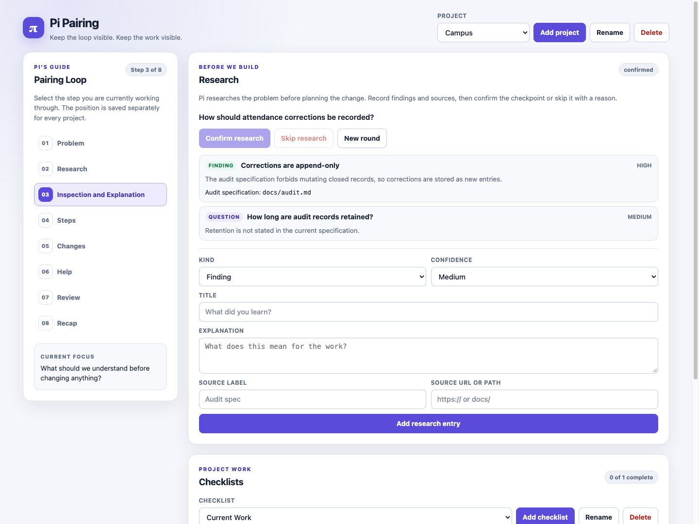

# Pi Pairing

**A research-first pair-programming companion for Pi.** It keeps a visible seven- (now eight-) step engineering loop, a sourced research area, and your project checklists in one local dashboard that Pi and you can both update.

[](LICENSE)



## Why this exists

Most coding agents jump straight to an implementation. That is fast, but it teaches very little and hides the reasoning that makes the next problem easier.

Pi Pairing changes the order of work:

1. **The problem is stated.** Scope and success criteria are written down.
2. **The problem is researched.** Findings are recorded with real sources before any design happens.
3. **The code is inspected.** The local architecture is explained in plain language.
4. **The work is sliced** into small, verifiable steps.
5. **You drive** while Pi navigates, coaches, and explains.
6. **The result is reviewed** with fresh evidence.
7. **The session is recapped** so the reasoning transfers to the next problem.

## Features

- **Eight-step pairing loop** with a per-project current position.
- **A dedicated Research panel** with research rounds, findings, questions, decisions, sources, and confidence.
- **An enforced research gate.** The loop cannot advance past Research until the round is confirmed or explicitly skipped with a recorded reason.
- **Visible research skips.** A skipped round is warned about in the dashboard, the CLI, and the final recap.
- **Project checklists** with items that can be added, completed, renamed, reordered, and deleted.
- **A CLI** so Pi and you can update the dashboard from any directory.
- **Live synchronization** over Server-Sent Events, with revision ordering so stale updates never overwrite newer work.
- **Local-first storage** with atomic writes, owner-only permissions, a single-writer lock, and export/import.
- **Loopback-only server** with JSON-only commands and Host/Origin validation.
- **No third-party dependencies.** Node.js standard library only.

## Install

### As a Pi package (recommended)

```bash
pi install github:brando008/pi-pairing
```

### By cloning

```bash
git clone https://github.com/brando008/pi-pairing.git
cd pi-pairing
./scripts/install.sh
```

The installer:

- checks that Node.js 18 or newer is available,
- links the `pi-pairing` skill into `~/.pi/agent/skills/`,
- creates a `pi-pairing` CLI wrapper in `~/.pi/agent/bin/`,
- starts the local dashboard,
- prints the dashboard URL.

Use `./scripts/install.sh --no-server` to skip starting the server, and
`./scripts/uninstall.sh --purge-data` to remove the skill, wrapper, server, and
saved data.

On Windows, run `powershell -ExecutionPolicy Bypass -File scripts/install.ps1`.

## Start the dashboard

```bash
npm start
```

Then open <http://127.0.0.1:4173>.

The server binds to `127.0.0.1` only. From anywhere else you can start it
idempotently:

```bash
./scripts/ensure-server.sh
```

Stop it with:

```bash
./scripts/stop-server.sh
```

## Use it with Pi

Start a Pi session in any repository and say:

```text
Let's use the Pi Pairing method on ~/GitHub/campus.
```

or invoke the skill explicitly:

```text
/skill:pi-pairing ~/GitHub/campus Implement the attendance endpoint
```

Pi will:

1. Load the `pi-pairing` skill and its session guide.
2. Ensure the dashboard server is running.
3. Create or select the `campus` project and a `Current Work` checklist.
4. Start a **research round** for the problem and record sourced findings.
5. Present the research and wait for your confirmation.
6. Inspect the repository and propose one small, testable step.
7. Guide you through the change, then review and verify it.
8. Recap what you learned, including any skipped research.

## The eight-step loop

| Step | What happens |
|---|---|
| **Problem** | Goal, scope, constraints, and success criteria are written down. |
| **Research** | The problem domain is investigated and findings are recorded with sources. |
| **Inspection and Explanation** | The relevant code is read and the local architecture is explained. |
| **Steps** | The work is broken into small, independently verifiable slices. |
| **Changes** | You implement; Pi navigates, coaches, and explains each change. |
| **Help** | Assistance escalates gradually: direction, pseudocode, specific guidance, walkthrough. |
| **Review** | The diff is inspected and fresh verification is run against the final tree. |
| **Recap** | The reasoning, evidence, and next step are reviewed together. |

## The research gate

Research is a phase with evidence, not a formality.

- A research **round** belongs to one problem. Start a new round for each new problem; earlier rounds stay as project history.
- A **finding** must have at least one source — a URL or a local file path.
- **Questions** and **decisions** may be recorded without sources.
- Pi cannot advance the loop past **Research** until the round is confirmed.
- You can always skip research, but a reason is required and the skip is shown as a warning everywhere and mentioned in the recap.

Research entries can be written by Pi through the CLI or by you in the dashboard.

## CLI reference

The installer creates `~/.pi/agent/bin/pi-pairing`. Without the wrapper, run
`node <tool-root>/cli.js`.

```bash
pi-pairing project add "Campus"
pi-pairing project select "Campus"
pi-pairing project rename "Campus" "Campus App"
pi-pairing project delete "Campus"

pi-pairing checklist add "Campus" "Current Work"
pi-pairing checklist select "Campus" "Current Work"
pi-pairing checklist rename "Campus" "Current Work" "Backend"
pi-pairing checklist delete "Campus" "Current Work"

pi-pairing item add "Campus" "Current Work" "Inspect the handler"
pi-pairing item complete "Campus" "Current Work" "Inspect the handler"
pi-pairing item reopen "Campus" "Current Work" "Inspect the handler"
pi-pairing item rename "Campus" "Current Work" "Inspect the handler" "Inspect the request path"
pi-pairing item move "Campus" "Current Work" "Inspect the handler" up
pi-pairing item delete "Campus" "Current Work" "Inspect the handler"

pi-pairing research begin "Campus" "How should corrections be recorded?"
pi-pairing research add "Campus" finding "Corrections are append-only" \
  "The audit specification forbids mutating closed records." \
  --source "Audit specification|docs/audit.md" --confidence high
pi-pairing research add "Campus" question "How long are records retained?" "Not answered yet."
pi-pairing research list "Campus"
pi-pairing research confirm "Campus"
pi-pairing research skip "Campus" "Existing incident review covered this area"

pi-pairing loop set "Campus" Research
pi-pairing loop set "Campus" "Inspection and Explanation"

pi-pairing projects
pi-pairing state
pi-pairing export ~/Desktop/pi-pairing-backup.json
pi-pairing import ~/Desktop/pi-pairing-backup.json
pi-pairing data-path
```

## Configuration

| Variable | Default | Purpose |
|---|---|---|
| `PI_PAIRING_URL` | `http://127.0.0.1:4173` | Dashboard URL used by the CLI. |
| `PI_PAIRING_DATA_DIR` | platform application data directory | Where the state file is stored. |
| `PI_PAIRING_STATE_FILE` | `<data dir>/state.json` | Exact state file path override. |
| `PORT` | `4173` | Port used by `npm start`. |

## Data and privacy

Everything stays on your machine. The server binds to loopback, static assets are
allowlisted, commands must be JSON, and Host/Origin checks block cross-origin
requests and DNS rebinding.

| Platform | Data directory |
|---|---|
| macOS | `~/Library/Application Support/PiPairing` |
| Linux | `${XDG_DATA_HOME:-~/.local/share}/pi-pairing` |
| Windows | `%LOCALAPPDATA%\PiPairing` |

The state file is written with owner-only permissions and protected by a
single-writer lock. Use `pi-pairing export` for backups and
`pi-pairing data-path` to locate it. If a server crashes and leaves a stale
lock, run `./scripts/unlock-server.sh` after confirming the recorded owner is
no longer running.

## Repository layout

```text
pi-pairing/
├── skills/pi-pairing/       # Installable Pi skill and session guide
├── scripts/                 # Install, uninstall, start, stop, unlock
├── core.js                  # State model, research rules, and the gate
├── commands.js              # Shared command layer
├── server.js                # Static, HTTP, and SSE server
├── state-store.js           # Atomic, locked persistence
├── cli.js                   # Command-line interface
├── app.js                   # Browser client
├── index.html / styles.css  # Dashboard
└── *.test.js                # Test suites
```

## Development

```bash
npm test              # unit, integration, and contract tests
npm run test:browser  # headless Chrome acceptance suite
```

The browser suite starts its own server and Chrome instance. Set `CHROME_PATH`
if Chrome or Chromium is not detected automatically.

See [CONTRIBUTING.md](CONTRIBUTING.md) for the workflow and
[docs/architecture.md](docs/architecture.md) for design details.

## Roadmap

- Reusable checklist and research templates.
- Optional project discovery from a configured directory.
- Encrypted state for shared machines.
- Export to Markdown for pull-request notes.

## License

[MIT](LICENSE)
