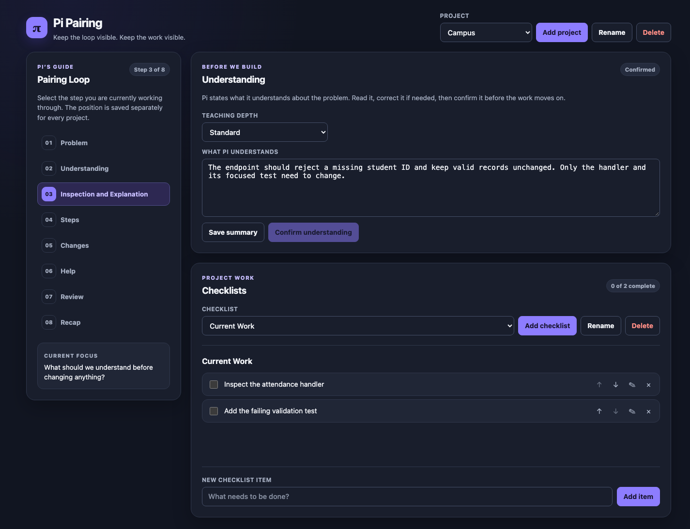

<div align="center">

# Pi Pairing

**An understanding-first pair-programming companion for [Pi](https://pi.dev).**

Keep the loop visible. Keep the work visible. Learn inside the work, not beside it.

[](https://github.com/brando008/pi-pairing/actions/workflows/ci.yml)
[](https://github.com/brando008/pi-pairing/releases/latest)
[](LICENSE)
[](https://nodejs.org)

</div>



<p align="center">
  <em>Light mode: <a href="docs/images/dashboard.png">dashboard.png</a></em>
</p>

---

## Contents

- [Philosophy](#philosophy)
- [Features](#features)
- [The loop](#the-loop)
- [Install](#install)
- [Use it on your own system](#use-it-on-your-own-system)
- [CLI reference](#cli-reference)
- [Data and privacy](#data-and-privacy)
- [Configuration](#configuration)
- [Troubleshooting](#troubleshooting)
- [Uninstall](#uninstall)
- [Development](#development)
- [Roadmap](#roadmap)
- [Contributing](#contributing)

---

## Philosophy

**Do the real work, at the right level of complexity, in a way that leaves you more capable than when you started.**

### Learning happens inside the work

This is why you drive. You are not studying code and then practicing — you are practicing while building something that matters. A generated solution with no thinking in between teaches very little.

### Comprehension is cheaper to fix than code

Before any implementation, Pi states what it understands about the problem and asks whether that matches your understanding. It is one question, at the cheapest possible moment, so a misunderstanding is corrected before it becomes an hour of wasted work.

### Complexity is a cost, not a virtue

Teaching something *fully* only helps if you need it *now*. Every project chooses a teaching depth:

| Depth | When to use it |
|---|---|
| **Concise** | New codebases, unfamiliar tooling, you want momentum. |
| **Standard** | The default: proportional explanation of the “why”. |
| **Deep** | Trade-offs and alternatives are themselves the interesting part. |

### Flow beats thoroughness in the moment

A concept that does not land is not an emergency. Pi rephrases once, shows one concrete example, then **keeps moving** and carries the concept forward as a `Revisit:` item on the dashboard. Repetition across sessions teaches more durably than a long detour in one session.

### Shared state removes coordination overhead

The loop position, the understanding summary, and the task list live in one visible place. Pi always knows where the session is, you always know what Pi thinks, and nothing important lives only in the chat scrollback.

### Evidence beats confidence

Pi does not say “it works” because the code looks right. It inspects the diff and runs the check against the final tree.

### What it refuses to be

| Not a… | Because… |
|---|---|
| Code generator | A finished solution teaches nothing by itself. |
| Study course | Lectures before real work waste the time you wanted to protect. |
| Project manager | Checklists support thinking; they do not replace it. |
| Research assistant | Research is a tool choice, not a mandatory phase. |
| Cloud service | Your project names, tasks, and notes stay on your machine. |
| Black box | The state is readable JSON, the skill is readable Markdown, every action is inspectable. |

---

## Features

- **Eight-step pairing loop** with a per-project current position.
- **Understanding checkpoint** — one editable summary, one confirmation, no research ceremony.
- **Per-project teaching depth** — Concise, Standard, or Deep.
- **Teach-forward coaching** — rephrase once, then keep moving; carried concepts become `Revisit:` items.
- **Project checklists** with items you can add, complete, rename, reorder, and delete.
- **A CLI** so Pi and you can update the dashboard from any directory.
- **Live synchronization** over Server-Sent Events, with revision ordering so stale updates never overwrite newer work.
- **Local-first storage** with atomic writes, owner-only permissions, a single-writer lock, and export/import.
- **Loopback-only server** with JSON-only commands and Host/Origin validation.
- **No third-party dependencies** — the Node.js standard library only.
- **An installable Pi skill** plus a detailed session guide.

---

## The loop

```text
Problem → Understanding → Inspection and Explanation → Steps
        → Changes → Help → Review → Recap
```

| Step | What happens |
|---|---|
| **1. Problem** | Pi restates the goal, the scope, and what “done” means. |
| **2. Understanding** | Pi states what it understands and the approach it proposes. You confirm or correct it. |
| **3. Inspection and Explanation** | Pi reads the real code and explains the part that matters to this problem. |
| **4. Steps** | The work is broken into small, independently verifiable slices. |
| **5. Changes** | You implement; Pi navigates, coaches, and explains each change. |
| **6. Help** | Assistance escalates gradually: Direction → Pseudocode → Specific guidance → Walkthrough. One rephrasing, then on to the next step. |
| **7. Review** | Pi inspects your diff and runs fresh verification against the final tree. |
| **8. Recap** | Pi teaches back what mattered, what was verified, and what comes next. |

The loop cannot advance past **Understanding** until the summary is confirmed. That is a cheap moment to catch a misunderstanding before any code exists.

---

## Install

### As a Pi package (recommended)

```bash
pi install github:brando008/pi-pairing
```

### By cloning

```bash
git clone https://github.com/brando008/pi-pairing.git
cd pi-pairing
./scripts/install.sh
```

The installer checks that Node.js 18+ is available, links the `pi-pairing` skill into
`~/.pi/agent/skills/`, creates a `pi-pairing` CLI wrapper in `~/.pi/agent/bin/`,
starts the local dashboard, and prints the URL.

Use `./scripts/install.sh --no-server` to skip starting the server.

### On Windows

```powershell
git clone https://github.com/brando008/pi-pairing.git
cd pi-pairing
powershell -ExecutionPolicy Bypass -File scripts/install.ps1
```

### Requirements

| Requirement | Version |
|---|---|
| Node.js | 18 or newer |
| Pi | any current release (skill format `SKILL.md`) |
| Browser | Chrome, Edge, Firefox, or Safari |
| Dependencies | none |

---

## Use it on your own system

### 1. Start the dashboard once

```bash
npm start
```

Open <http://127.0.0.1:4173> and keep it beside your editor. From anywhere else:

```bash
/Users/brando/GitHub/pairing/scripts/ensure-server.sh
```

The server binds to `127.0.0.1` only.

### 2. Start a Pi session in any repository

```bash
cd ~/GitHub/your-project
pi
```

### 3. Ask for the pairing method

```text
Let's use the Pi Pairing method on this repo.
```

or explicitly:

```text
/skill:pi-pairing Implement the attendance endpoint
```

### 4. What Pi does next

1. Loads the `pi-pairing` skill and its session guide.
2. Ensures the dashboard server is running.
3. Creates or selects a project named after your repository, plus a `Current Work` checklist.
4. Writes a short **understanding summary** and asks whether it matches your understanding.
5. Inspects the real code and explains it.
6. Proposes one small, test-first step for you to make.
7. Coaches, reviews, verifies, and recaps — updating the dashboard as it goes.

### 5. Across every folder and session

The state is global, so every repository appears in the same dashboard:

- Each repository gets its own project, checklist, loop position, and teaching depth.
- Returning to a repository later shows the same state, including carried-forward `Revisit:` items.
- A new task replaces the understanding summary; older checklists and history stay.

### 6. Change the teaching depth per project

In the dashboard, or from the CLI:

```bash
pi-pairing project depth "your-project" concise
```

### 7. Work autonomously when you want to

```text
Take over and implement this autonomously.
```

Pi announces the mode switch, still confirms the understanding summary itself, keeps the
dashboard live, verifies with fresh evidence, and gives you a short recap.

---

## CLI reference

The installer creates `~/.pi/agent/bin/pi-pairing`. Without the wrapper, run
`node <repo>/cli.js`.

```bash
# projects
pi-pairing project add "Campus"
pi-pairing project select "Campus"
pi-pairing project rename "Campus" "Campus App"
pi-pairing project delete "Campus"
pi-pairing project depth "Campus" concise

# understanding checkpoint
pi-pairing understanding set "Campus" "The endpoint rejects a missing student ID."
pi-pairing understanding confirm "Campus"
pi-pairing understanding show "Campus"

# checklists and items
pi-pairing checklist add "Campus" "Current Work"
pi-pairing checklist select "Campus" "Current Work"
pi-pairing checklist rename "Campus" "Current Work" "Backend"
pi-pairing checklist delete "Campus" "Backend"

pi-pairing item add "Campus" "Current Work" "Inspect the handler"
pi-pairing item complete "Campus" "Current Work" "Inspect the handler"
pi-pairing item reopen "Campus" "Current Work" "Inspect the handler"
pi-pairing item rename "Campus" "Current Work" "Inspect the handler" "Inspect the request path"
pi-pairing item move "Campus" "Current Work" "Inspect the handler" up
pi-pairing item delete "Campus" "Current Work" "Inspect the handler"

# workflow position
pi-pairing loop set "Campus" Understanding
pi-pairing loop set "Campus" "Inspection and Explanation"

# overview, backup, and maintenance
pi-pairing projects
pi-pairing state
pi-pairing export ~/Desktop/pi-pairing-backup.json
pi-pairing import ~/Desktop/pi-pairing-backup.json
pi-pairing data-path
```

---

## Data and privacy

Everything stays on your machine. The server binds to loopback, static assets are
allowlisted, commands must be JSON, and Host/Origin checks block cross-origin
requests and DNS rebinding.

| Platform | Data directory |
|---|---|
| macOS | `~/Library/Application Support/PiPairing` |
| Linux | `${XDG_DATA_HOME:-~/.local/share}/pi-pairing` |
| Windows | `%LOCALAPPDATA%\PiPairing` |

The state file is written with owner-only permissions and protected by a
single-writer lock. Run `pi-pairing data-path` to locate it.

---

## Configuration

| Variable | Default | Purpose |
|---|---|---|
| `PI_PAIRING_URL` | `http://127.0.0.1:4173` | Dashboard URL used by the CLI. |
| `PI_PAIRING_DATA_DIR` | platform application data directory | Where the state file is stored. |
| `PI_PAIRING_STATE_FILE` | `<data dir>/state.json` | Exact state file path override. |
| `PORT` | `4173` | Port used by `npm start`. |
| `CHROME_PATH` | auto-detected | Chrome/Chromium binary for the browser test suite. |

---

## Troubleshooting

**The dashboard shows “cannot connect to its local server”.**
Run `/Users/brando/GitHub/pairing/scripts/ensure-server.sh` and reload the page. The
browser reconnects on its own once the server is back.

**The skill is not found in Pi.**
The skill installs into `~/.pi/agent/skills/pi-pairing`. In a Pi session that was
already open, run `/reload`.

**“A stale Pi Pairing lock exists.”**
A previous server crashed. Confirm the recorded process is gone, then run
`/Users/brando/GitHub/pairing/scripts/unlock-server.sh`.

**Port 4173 is already in use.**
Run the server with a different port (`PORT=4174 npm start`) and point the CLI at it
with `PI_PAIRING_URL=http://127.0.0.1:4174`.

**I want to start over.**
Stop the server, delete the state file, and restart:

```bash
/Users/brando/GitHub/pairing/scripts/stop-server.sh
rm "$(pi-pairing data-path)"
npm start
```

---

## Uninstall

```bash
/Users/brando/GitHub/pairing/scripts/uninstall.sh
```

Add `--purge-data` to also delete your saved projects, checklists, and notes.

---

## Development

```bash
git clone https://github.com/brando008/pi-pairing.git
cd pi-pairing

npm test              # unit, integration, and contract tests
npm run test:browser  # headless Chrome acceptance suite
```

The browser suite starts its own server and Chrome instance. Set `CHROME_PATH` if
Chrome or Chromium is not detected automatically.

```text
pi-pairing/
├── skills/pi-pairing/       # Installable Pi skill and session guide
├── scripts/                 # Install, uninstall, start, stop, unlock
├── core.js                  # State model, understanding rules, and the gate
├── commands.js              # Shared command layer
├── server.js                # Static, HTTP, and SSE server
├── state-store.js           # Atomic, locked persistence
├── cli.js                   # Command-line interface
├── app.js                   # Browser client
├── index.html / styles.css  # Dashboard
└── *.test.js                # Test suites
```

---

## Roadmap

- Reusable checklist templates and depth presets.
- Optional project discovery from a configured directory.
- Encrypted state for shared machines.
- Export to Markdown for pull-request notes.

---

## Contributing

Issues and pull requests are welcome. Please read
[CONTRIBUTING.md](CONTRIBUTING.md) and [CODE_OF_CONDUCT.md](CODE_OF_CONDUCT.md) first.
Security issues go to the process in [SECURITY.md](SECURITY.md), not the issue tracker.

---

## License

[MIT](LICENSE) © 2026 brando008
